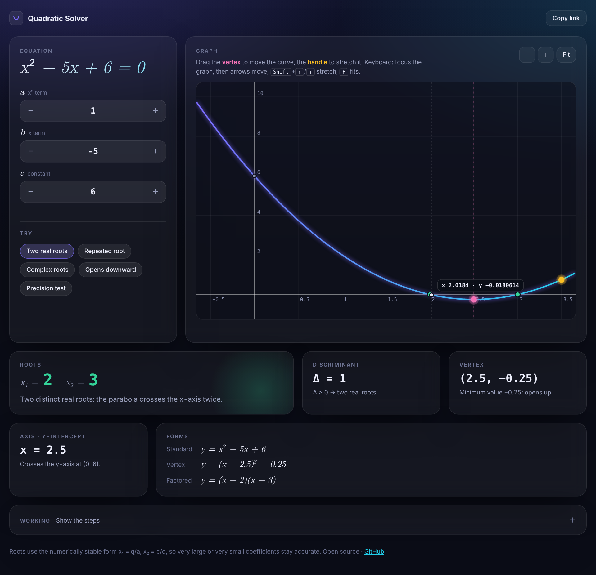

# Quadratic Solver

Solve **ax² + bx + c = 0** and see what the numbers mean. You get roots that stay accurate at extreme coefficients,
the vertex, the axis and the three standard forms, plus a parabola you can reshape by dragging.

**Live:** https://shashankedu02.github.io/quadratic-solver/

[](https://github.com/shashankedu02/quadratic-solver/actions/workflows/ci.yml)



## Features

- **Numerically stable roots.** The textbook formula (−b ± √Δ) / 2a subtracts two nearly equal numbers when b² ≫ 4ac.
  This app uses q = −(b + sign(b)·√Δ)/2, x₁ = q/a, x₂ = c/q instead.
  - Try the *Precision test* preset (a = 1, b = 10⁸, c = 1): both roots, −10⁸ and −10⁻⁸, come out accurate.
- **Real, repeated and complex roots**, with the discriminant explained.
- **Vertex, axis of symmetry, y-intercept, and min/max.**
- **Standard, vertex and factored forms**, plus a step-by-step working panel with a Vieta check.
- **An interactive graph:**
  - drag the vertex to move the curve, and the handle to stretch it;
  - grid labels adapt to any scale, and the view fits itself to the roots and vertex;
  - hover to read (x, y), and zoom or fit with the toolbar.
- **Keyboard support.**
  - On the graph: arrows move the vertex, <kbd>Shift</kbd>+<kbd>↑</kbd>/<kbd>↓</kbd> stretch it, <kbd>F</kbd> refits.
  - In the inputs: <kbd>↑</kbd>/<kbd>↓</kbd> step the value (<kbd>Shift</kbd> for ×10).
- **Shareable links:** the coefficients live in the URL (`?a=1&b=-5&c=6`).
- **Dark and light themes** that follow your system setting. No external fonts, scripts or trackers.

## Run locally

It is a static site, so any local web server works (ES modules don't load from `file://`):

```bash
python -m http.server 8000
# open http://localhost:8000
```

## Tests

The maths lives in `src/quadratic.js`, separate from the interface, and is tested with Node's built-in test runner.
No dependencies are needed.

```bash
node --test tests/*.test.js
```

The tests cover:
- each root type, and the large-b precision case (checked by relative residual);
- rounding near Δ = 0;
- rejection of a = 0 and non-finite input;
- vertex round trips;
- the graph fit containing every point of interest;
- number and polynomial formatting.

## Structure

```
index.html          markup and accessibility labels
styles.css          dark/light design tokens and layout
src/quadratic.js    pure maths: solve, describe, forms, view fitting (no DOM)
src/app.js          interface: inputs, results, canvas graph, dragging, URL state
tests/              node:test suite for src/quadratic.js
```

## Limitations

- Real coefficients only. Coefficients beyond about 10¹⁵⁴ overflow b² in double precision.
- Dragging the stretch handle keeps |a| ≥ 0.001 (at a = 0 the curve is a straight line), and the app says so while
  it is holding the value.

## License

[MIT](LICENSE)
